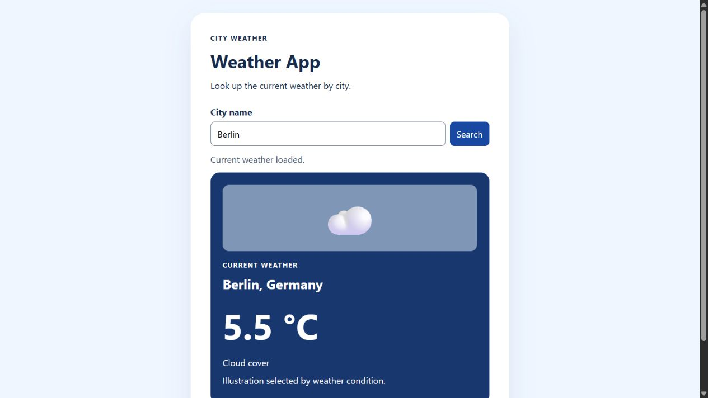

# Weather App

Search for a city to see its current temperature and weather conditions. Built with HTML, CSS, and vanilla JavaScript.

## Live demo

[Try Weather App](https://shariatypour.github.io/Weather-App/)

## Run locally

Serve this folder with a local web server and open `index.html`. The app needs internet access to reach Open-Meteo. No API key or build step is needed for this demo.

## How it works

1. Fetch the city coordinates from the Open-Meteo Geocoding API.
2. Fetch the current temperature and weather code using those coordinates.
3. Show a sun for clear skies, a rain illustration for drizzle, rain or storms, and a cloud illustration for other conditions. The text shows the reported condition separately.

The interface handles missing cities, failed requests, and timeouts.

Weather data by [Open-Meteo](https://open-meteo.com/).
